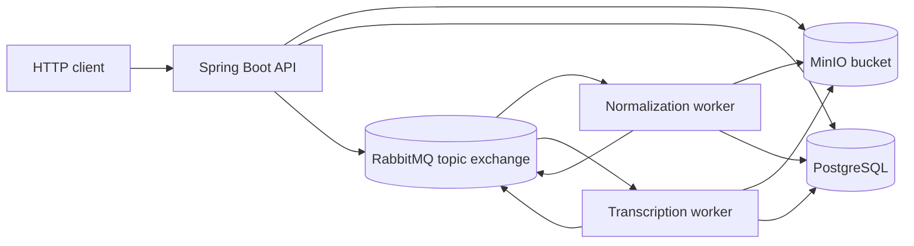
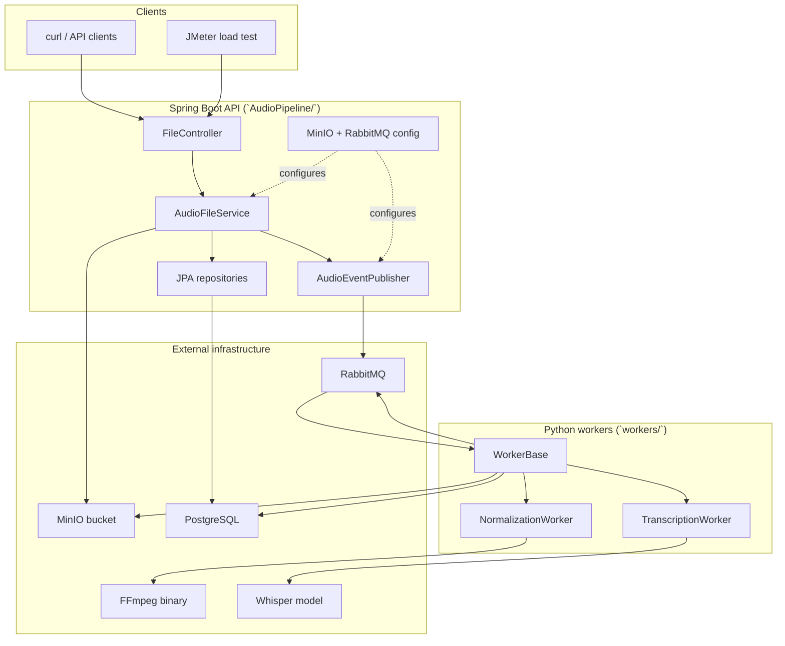

# Overview

This repository implements an asynchronous audio ingestion pipeline with two main runtime components:

1. A Spring Boot API that accepts uploads, stores the raw file in MinIO, persists metadata in PostgreSQL, creates a processing job record, publishes an event to RabbitMQ, and returns `202 Accepted`.
2. Python workers that consume RabbitMQ events, normalize audio with FFmpeg, transcribe audio with Whisper, write results back to storage/database, and publish follow-up events.

Related docs:

- [Request Flow](./02-request-flow.md)
- [API Reference](./04-api-reference.md)
- [Database](./05-database.md)
- [Business Logic](./07-business-logic.md)
- [Deployment](./10-deployment.md)

## What The Project Is

The codebase is a case-study style backend project. The top-level [`README.md`](../README.md) frames it as a comparison between:

- a synchronous baseline where upload work blocks the request thread
- an asynchronous design where upload returns quickly and downstream stages execute out of band

The current code in this repository only contains the asynchronous architecture. The synchronous baseline is described in prose and screenshots, not implemented as a separate code path.

## Main Responsibilities

The implemented system is responsible for:

- receiving multipart audio uploads over HTTP
- storing original audio in MinIO
- storing upload metadata and pipeline status in PostgreSQL
- publishing `audio.uploaded` events to RabbitMQ
- normalizing audio in a background worker
- transcribing normalized audio in a background worker
- exposing job status and transcript retrieval endpoints
- providing local orchestration scripts for Docker infrastructure, API startup, and worker startup

It is not currently responsible for:

- authentication or authorization
- rate limiting
- user accounts or tenancy
- API versioning
- deleting audio/transcripts
- reprocessing or replay workflows
- operational metrics beyond logs

## High-Level Architecture

## Component Architecture

## External Services Used

### Required by the implemented async flow

- **PostgreSQL**: primary application database, configured in [`AudioPipeline/src/main/resources/application.yaml`](../AudioPipeline/src/main/resources/application.yaml) and consumed by both Java and Python.
- **RabbitMQ**: message broker and queue topology, configured in [`AudioPipeline/src/main/java/com/AudioPipeline/Configuration/RabbitMqConfig.java`](../AudioPipeline/src/main/java/com/AudioPipeline/Configuration/RabbitMqConfig.java) and also redeclared by [`workers/worker_base.py`](../workers/worker_base.py).
- **MinIO**: S3-compatible object storage, configured in [`AudioPipeline/src/main/java/com/AudioPipeline/Configuration/MinioConfig.java`](../AudioPipeline/src/main/java/com/AudioPipeline/Configuration/MinioConfig.java) and [`workers/.env.example`](../workers/.env.example).

### Required by workers

- **FFmpeg**: required by [`workers/normalization_worker.py`](../workers/normalization_worker.py) for loudness normalization.
- **OpenAI Whisper model files**: downloaded/loaded by [`workers/transcription_worker.py`](../workers/transcription_worker.py). The repo uses the open-source `openai-whisper` Python package, not the OpenAI API.

### Used for testing and demonstration

- **Apache JMeter**: load-test plan stored in [`AudioPipeline/src/main/java/com/AudioPipeline/utils/Graph Results.jmx`](../AudioPipeline/src/main/java/com/AudioPipeline/utils/Graph%20Results.jmx).

## Tech Stack

### Java API

- Java 21
- Spring Boot 4.0.3
- Spring MVC
- Spring Data JPA / Hibernate ORM 7
- Spring AMQP
- MinIO Java SDK
- PostgreSQL JDBC driver
- Lombok

Defined in [`AudioPipeline/pom.xml`](../AudioPipeline/pom.xml).

### Python workers

- Python 3
- `pika` for RabbitMQ
- `psycopg2-binary` for PostgreSQL
- `minio` for object storage
- `ffmpeg-python`
- `openai-whisper`
- `python-dotenv`
- `python-json-logger`

Defined in [`workers/requirements.txt`](../workers/requirements.txt).

### Infra and operations

- Docker Compose
- Bash orchestration scripts
- Checked-in runtime logs and PIDs

## Folder Structure

| Folder | Purpose |
| --- | --- |
| `AudioPipeline/` | Spring Boot application module. |
| `workers/` | Python background workers, env files, logs, PID files, local virtualenvs. |
| `scripts/` | Startup and shutdown scripts for infra and workers. |
| `images/` | Benchmark screenshots and demo output images. |
| `flow/` | Older hand-written architecture notes; useful as intent, not always accurate to the current code. |
| `runtime/` | API PID and API log generated by helper scripts. |
| `jmeter/` | Extra JMeter log output. |
| `docs/` | Reverse-engineered documentation added in this pass. |

## Important Reality Checks

- The top-level README mentions H2 for development, but the active configuration defaults to PostgreSQL in [`application.yaml`](../AudioPipeline/src/main/resources/application.yaml). H2 is represented only by checked-in data files and a fully commented-out H2 console config class.
- The Spring app publishes RabbitMQ events but does **not** contain message listeners. Actual async processing lives in Python.
- There is no authentication implementation anywhere in the repository.
- Secrets are present in committed `.env` files. This is a repository risk, documented in [Security](./11-security.md) and [Questions](./14-questions.md).
