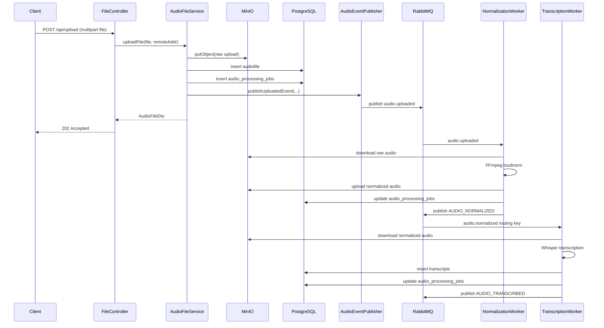
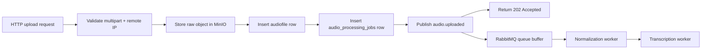
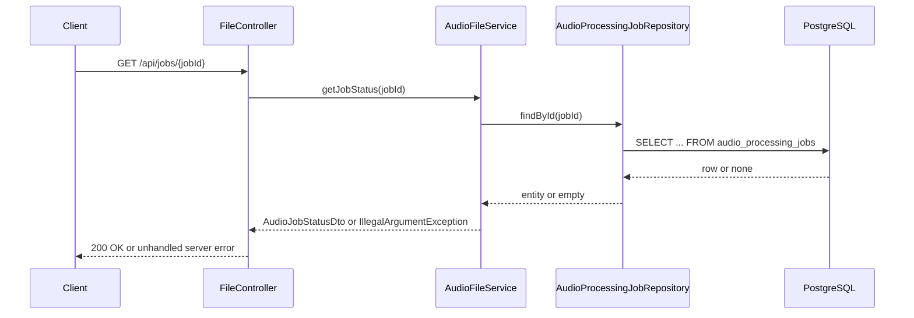
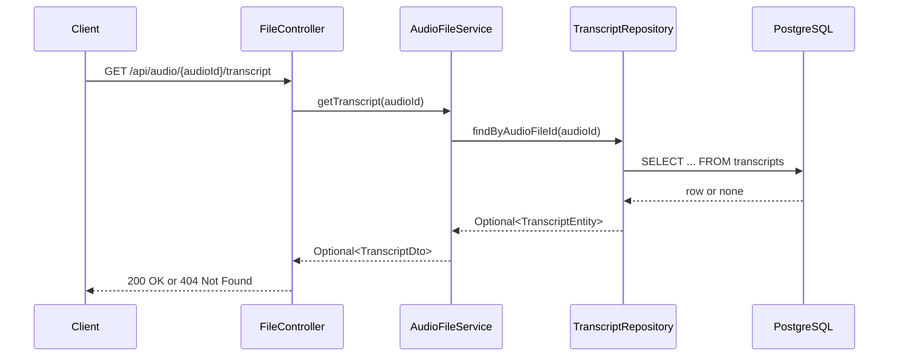
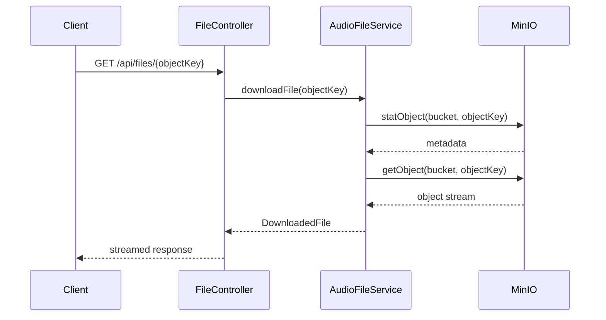

# Request Flow

Related docs:

- [Overview](./01-overview.md)
- [API Reference](./04-api-reference.md)
- [Authentication](./06-authentication.md)
- [Code Walkthrough](./12-code-walkthrough.md)

## End-to-End Lifecycle Of An Upload Request

The main business flow starts at `POST /api/upload` in [`FileController`](../AudioPipeline/src/main/java/com/AudioPipeline/controller/FileController.java).

## Request/Async Boundary

## HTTP Middleware / Filter Execution Order

There are no custom filters, interceptors, or security middleware in the codebase.

The effective request path is mostly Spring Boot defaults:

1. Embedded Tomcat accepts the request.
2. Standard servlet filters run.
3. Spring MVC dispatches to the controller.
4. Controller delegates to service.
5. Service performs storage/database/broker work.
6. Controller returns the serialized DTO.

The runtime stack trace in [`runtime/api.log`](../runtime/api.log) shows default filters such as:

- `WsFilter`
- `RequestContextFilter`
- `FormContentFilter`
- `CharacterEncodingFilter`

There is no `Spring Security` filter chain because Spring Security is not a dependency.

## Authentication

There is none.

- No auth dependency in [`AudioPipeline/pom.xml`](../AudioPipeline/pom.xml)
- No `SecurityFilterChain`
- No JWT/session/api-key code
- No endpoint annotations for authorization

See [Authentication](./06-authentication.md).

## Validation

Validation is minimal and split between Spring MVC and service code:

- `POST /api/upload` only accepts `multipart/form-data` because of the `@PostMapping` `consumes` declaration in [`FileController`](../AudioPipeline/src/main/java/com/AudioPipeline/controller/FileController.java).
- `AudioFileService.uploadFile(...)` rejects `null` or empty files with `IllegalArgumentException`.
- `GET /api/files/{objectKey}` rejects blank `objectKey` values in [`AudioFileService.downloadFile(...)`](../AudioPipeline/src/main/java/com/AudioPipeline/service/AudioFileService.java).
- There is no filename extension whitelist, MIME whitelist, antivirus scan, transcript validation, or upload content validation.
- DTO validation annotations on [`AudioFileDto`](../AudioPipeline/src/main/java/com/AudioPipeline/dto/AudioFileDto.java) are not applied to requests because this DTO is used as a response model, not a `@RequestBody`.

## Controllers

The only controller is [`FileController`](../AudioPipeline/src/main/java/com/AudioPipeline/controller/FileController.java). It exposes four endpoints:

- `POST /api/upload`
- `GET /api/files/{objectKey}`
- `GET /api/jobs/{jobId}`
- `GET /api/audio/{audioId}/transcript`

The controller is thin. It does not hold business logic beyond:

- reading `request.getRemoteAddr()`
- building an absolute status URL from the relative path returned by the service
- wrapping service results in `ResponseEntity`

## Services

### `AudioFileService`

Responsible for:

- bucket existence check
- object key generation
- MinIO upload/download
- JPA persistence for `audiofile` and `audio_processing_jobs`
- job status lookup
- transcript lookup

### `AudioEventPublisher`

Responsible for:

- wrapping stage payloads in an `AudioPipelineEvent`
- assigning `eventId`, `occurredAt`, and `eventVersion`
- publishing to the configured topic exchange

## Database Writes During Upload

Upload causes two writes:

1. `audiofile`
   - stores uploader IP
   - stores raw MinIO object key
   - stores `created_at`
2. `audio_processing_jobs`
   - stores link to `audiofile`
   - stores current stage/status
   - stores current object key
   - stores trace ID
   - stores timestamps and error fields

The Java service does not create transcript rows. Those are created later by the Python transcription worker.

## Response Shape

`POST /api/upload` returns `202 Accepted` with [`AudioFileDto`](../AudioPipeline/src/main/java/com/AudioPipeline/dto/AudioFileDto.java):

- `audioId`
- `jobId`
- `filePath`
- `stage`
- `status`
- `traceId`
- `statusUrl`

The `statusUrl` is converted from relative form in the service to an absolute URL in the controller.

## Non-Upload Read Flows

### `GET /api/jobs/{jobId}`

Flow:

1. controller calls `audioFileService.getJobStatus(jobId)`
2. service loads `AudioProcessingJobEntity` via JPA
3. if missing, `IllegalArgumentException` bubbles up as a 500-style failure because there is no exception mapper
4. otherwise response is serialized from `AudioJobStatusDto`

### `GET /api/audio/{audioId}/transcript`

Flow:

1. controller calls `audioFileService.getTranscript(audioId)`
2. service queries `TranscriptRepository.findByAudioFileId`
3. controller returns `200` with DTO when present, `404` otherwise

### `GET /api/files/{objectKey}`

Flow:

1. controller calls `audioFileService.downloadFile(objectKey)`
2. service runs `statObject` then `getObject` against MinIO
3. controller streams bytes back as `InputStreamResource`

## Known Flow Mismatches

- The event `eventType` emitted by Java is lowercase dotted (`audio.uploaded`), while Python publishes uppercase snake-like values (`AUDIO_NORMALIZED`, `AUDIO_TRANSCRIBED`) even though routing keys remain lowercase dotted. Consumers currently key off routing/binding and payload, not `eventType`.
- The worker idempotency check currently treats a job in `UPLOAD/QUEUED` as a duplicate and skips it, which can prevent normalization from running. This behavior is visible in [`workers/normalization_worker.log`](../workers/normalization_worker.log).
