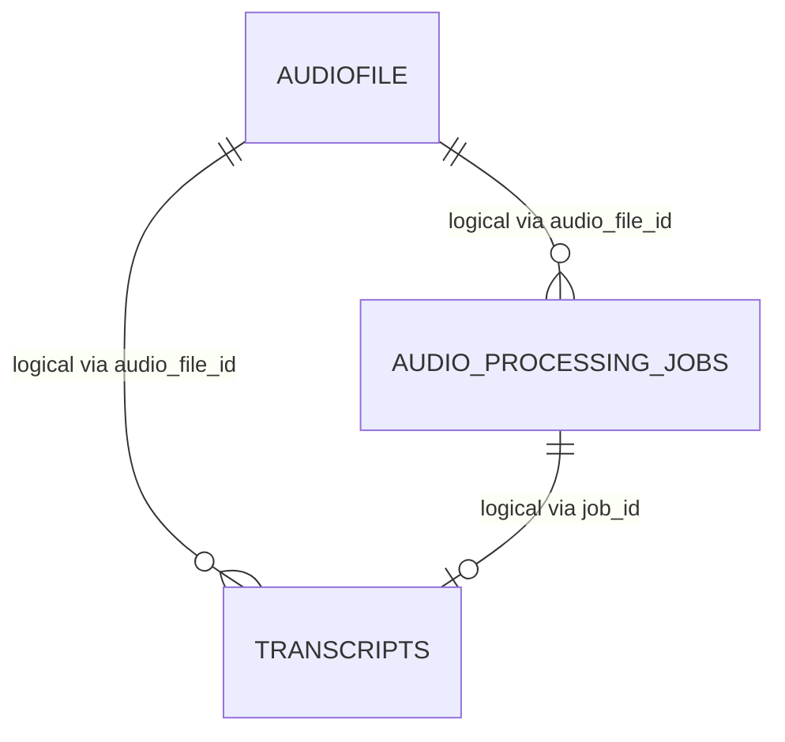
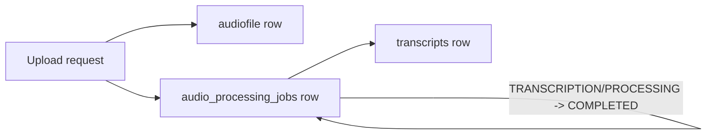

# Database

Related docs:

- [Request Flow](./02-request-flow.md)
- [Business Logic](./07-business-logic.md)
- [Config](./09-config.md)

## Which Database Is Actually Used

The active application configuration defaults to PostgreSQL in [`AudioPipeline/src/main/resources/application.yaml`](../AudioPipeline/src/main/resources/application.yaml).

There are also checked-in H2 files in `AudioPipeline/data/`, but they represent an older/local setup rather than the default runtime path.

Evidence:

- Java datasource defaults to PostgreSQL
- Python workers connect to PostgreSQL via `DATABASE_URL` or DB host/port env vars
- runtime logs in [`runtime/api.log`](../runtime/api.log) show the app connected to PostgreSQL 17

## Schema Source Of Truth

There are no SQL migrations. Schema is generated implicitly from JPA entities with:

- `spring.jpa.hibernate.ddl-auto=update`

Source entities:

- [`AudioFilesEntity`](../AudioPipeline/src/main/java/com/AudioPipeline/entity/AudioFilesEntity.java)
- [`AudioProcessingJobEntity`](../AudioPipeline/src/main/java/com/AudioPipeline/entity/AudioProcessingJobEntity.java)
- [`TranscriptEntity`](../AudioPipeline/src/main/java/com/AudioPipeline/entity/TranscriptEntity.java)

The checked-in H2 database also contains matching table definitions, visible via `strings` on `audiopipeline.mv.db`.

## Tables

### `audiofile`

Purpose:

- one row per uploaded raw audio object

Columns:

- `id` bigint identity primary key
- `ip_address` varchar not null
- `file_path` varchar not null
- `created_at` timestamp not null

Why it exists:

- decouples file metadata from pipeline execution status
- preserves original upload object key even after downstream job object keys change

Relationships:

- logical parent of `audio_processing_jobs.audio_file_id`
- logical parent of `transcripts.audio_file_id`

Important note:

- no foreign key constraints are declared in JPA

### `audio_processing_jobs`

Purpose:

- tracks the state machine for processing work

Columns:

- `id` bigint identity primary key
- `audio_file_id` bigint not null
- `stage` varchar(50) not null
- `status` varchar(50) not null
- `retry_count` integer not null
- `object_key` varchar(512) not null
- `trace_id` varchar(100) not null
- `error_code` varchar(100) nullable
- `error_message` varchar(1000) nullable
- `created_at` timestamp not null
- `started_at` timestamp nullable
- `completed_at` timestamp nullable
- `updated_at` timestamp not null

Why it exists:

- exposes async progress to clients
- gives workers a shared state record across processing stages
- carries error information and the current object location

Important semantics:

- `object_key` mutates over time
  - initially raw upload key
  - later normalized file key
  - later transcript pseudo-key

### `transcripts`

Purpose:

- stores final transcript payloads generated by Whisper

Columns:

- `id` bigint identity primary key
- `audio_file_id` bigint not null
- `job_id` bigint not null
- `transcript_text` text
- `language` varchar(10)
- `confidence` double precision / float
- `created_at` timestamp not null

Why it exists:

- supports transcript retrieval without re-running transcription
- preserves language/confidence metadata

## Relationships

The schema is relational by convention rather than by enforced FK constraints.

## Data Lifecycle Diagram

## Indexes

Explicitly visible in code / generated DDL:

- primary key index on `audiofile.id`
- primary key index on `audio_processing_jobs.id`
- primary key index on `transcripts.id`

Not present but likely desirable:

- index on `audio_processing_jobs.audio_file_id`
- index on `audio_processing_jobs.trace_id`
- index on `transcripts.audio_file_id`
- unique or indexed constraint on `transcripts.job_id` or `audio_file_id`, depending on intended cardinality

## Constraints

Present:

- `NOT NULL` constraints from entity annotations
- string lengths on several columns
- primary keys

Absent:

- foreign keys
- check constraints for valid stage/status values
- uniqueness constraints
- transcript deduplication constraints

## Important Queries

### Java / JPA

- `findById(jobId)` via [`AudioProcessingJobRepository`](../AudioPipeline/src/main/java/com/AudioPipeline/repository/AudioProcessingJobRepository.java)
- `findByAudioFileId(audioId)` via [`TranscriptRepository`](../AudioPipeline/src/main/java/com/AudioPipeline/repository/TranscriptRepository.java)
- `save(audiofile)` and `save(job)`

### Python / SQL

In [`workers/worker_base.py`](../workers/worker_base.py):

- `UPDATE audio_processing_jobs ...` for `PROCESSING`, `COMPLETED`, and `FAILED`
- `SELECT stage, status FROM audio_processing_jobs WHERE id = %s` for idempotency

In [`workers/transcription_worker.py`](../workers/transcription_worker.py):

- `INSERT INTO transcripts (...) VALUES (...)`

## Timestamp Behavior

- `audiofile.created_at` uses Hibernate `@CreationTimestamp`
- `audio_processing_jobs.created_at` and `updated_at` are set in `@PrePersist`
- `audio_processing_jobs.updated_at` is updated in `@PreUpdate`
- worker SQL also sets `started_at`, `completed_at`, and `updated_at` manually
- `transcripts.created_at` is set by `@PrePersist` in Java and `CURRENT_TIMESTAMP` in Python SQL insert

This means timestamp ownership is mixed across frameworks and languages.

## Drift Risks

Because schema is migrationless and shared across Java and Python:

- JPA changes can silently alter production schema
- worker SQL can fall out of sync with entity definitions
- local H2 files can drift from PostgreSQL reality

For long-term maintenance, explicit migrations would be safer than `ddl-auto=update`.
