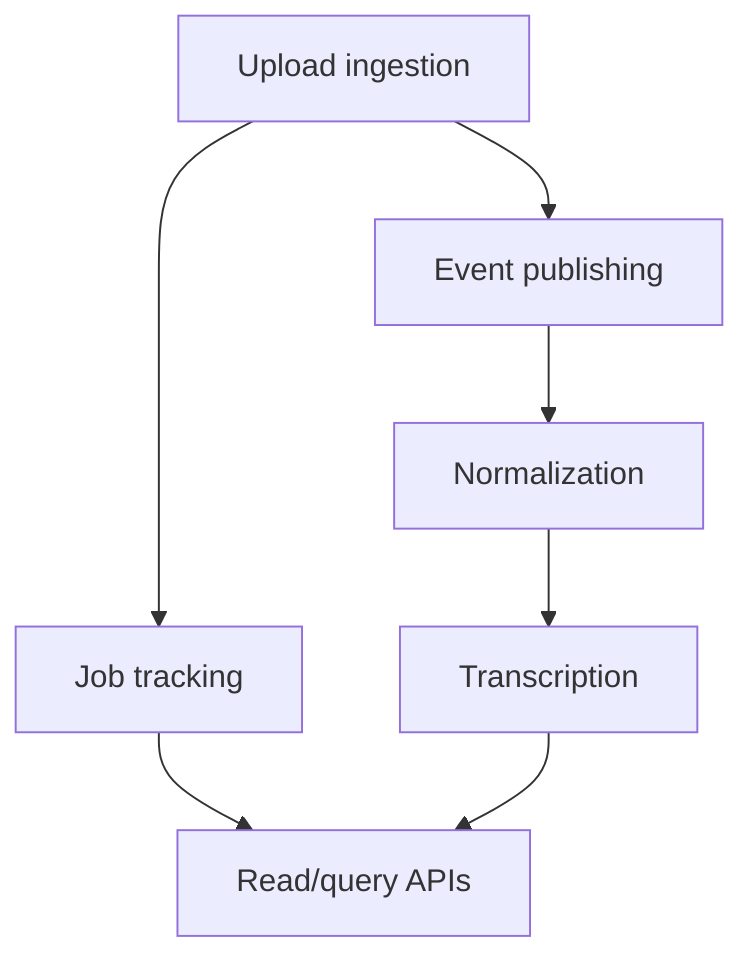
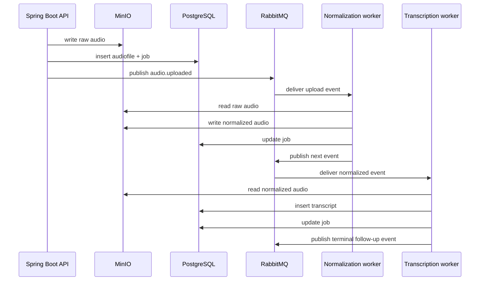

# Business Logic

This document breaks the system into business modules and explains what each one does and why.

Related docs:

- [Overview](./01-overview.md)
- [Request Flow](./02-request-flow.md)
- [Database](./05-database.md)

## Module Map

## Business Module Sequence

## 1. Upload Ingestion

Source files:

- [`FileController`](../AudioPipeline/src/main/java/com/AudioPipeline/controller/FileController.java)
- [`AudioFileService`](../AudioPipeline/src/main/java/com/AudioPipeline/service/AudioFileService.java)
- [`AudioFilesEntity`](../AudioPipeline/src/main/java/com/AudioPipeline/entity/AudioFilesEntity.java)

What it does:

- accepts multipart upload
- generates a sanitized MinIO object key with UUID prefix
- stores raw audio in object storage
- records uploader IP and object key in the database

Why it exists:

- raw audio is too large for relational storage
- upload metadata still needs to be queryable and durable

Important implementation details:

- filename sanitization replaces non `[a-zA-Z0-9._-]` chars with `_`
- bucket creation is lazy and per-request via `ensureBucketExists()`
- the raw file path is returned to the caller

## 2. Job Tracking

Source files:

- [`AudioProcessingJobEntity`](../AudioPipeline/src/main/java/com/AudioPipeline/entity/AudioProcessingJobEntity.java)
- [`AudioProcessingJobRepository`](../AudioPipeline/src/main/java/com/AudioPipeline/repository/AudioProcessingJobRepository.java)
- [`AudioFileService.getJobStatus`](../AudioPipeline/src/main/java/com/AudioPipeline/service/AudioFileService.java)
- worker SQL in [`worker_base.py`](../workers/worker_base.py)

What it does:

- tracks stage and status through the async pipeline
- stores trace ID for cross-component correlation
- stores current object key as the artifact changes shape
- stores failures and timestamps

Why it exists:

- async systems need durable progress separate from request lifecycle
- clients need a polling target
- workers need a shared state row

Observed stage/status vocabulary:

- stages: `UPLOAD`, `NORMALIZATION`, `TRANSCRIPTION`
- status values: `QUEUED`, `PROCESSING`, `COMPLETED`, `FAILED`

There is no enum enforcement in Java or SQL.

## 3. Event Publishing

Source files:

- [`AudioEventPublisher`](../AudioPipeline/src/main/java/com/AudioPipeline/service/AudioEventPublisher.java)
- [`AudioPipelineEvent`](../AudioPipeline/src/main/java/com/AudioPipeline/dto/AudioPipelineEvent.java)
- [`AudioStagePayload`](../AudioPipeline/src/main/java/com/AudioPipeline/dto/AudioStagePayload.java)

What it does:

- creates the stage event envelope
- sets event metadata
- publishes to the RabbitMQ topic exchange

Why it exists:

- decouples ingestion latency from heavy processing
- turns the database row + object key into a portable async contract

Contract shape:

- envelope: `eventType`, `eventVersion`, `eventId`, `occurredAt`, `traceId`, `payload`
- payload: `audioFileId`, `jobId`, `objectKey`

## 4. Queue Topology

Source files:

- [`RabbitMqConfig`](../AudioPipeline/src/main/java/com/AudioPipeline/Configuration/RabbitMqConfig.java)
- [`RabbitMqProperties`](../AudioPipeline/src/main/java/com/AudioPipeline/Configuration/RabbitMqProperties.java)
- mirrored setup in [`worker_base.py`](../workers/worker_base.py)

What it does:

- defines topic exchange
- defines dead-letter exchange
- defines normalization/transcription/embedding queues and DLQs
- binds routing keys to stage queues

Why it exists:

- stage-specific queues make worker scaling and failure isolation possible
- DLQs prevent poison messages from endlessly requeueing after rejection without requeue

Important note:

- the `embedding` queue exists in topology only; there is no embedding worker implementation in the repository

## 5. Audio Normalization

Source files:

- [`normalization_worker.py`](../workers/normalization_worker.py)
- [`worker_base.py`](../workers/worker_base.py)

What it does:

- consumes upload events from RabbitMQ
- downloads raw audio from MinIO
- runs FFmpeg `loudnorm`
- writes a normalized MP3 back to MinIO under `normalized/{audioFileId}.mp3`
- updates job status
- publishes the next-stage event

Why it exists:

- downstream transcription works better on normalized input
- a consistent audio policy also makes the pipeline more predictable

Normalization parameters:

- target loudness `-16 LUFS`
- true peak `-1.5`
- loudness range `11`
- output codec `libmp3lame`
- bitrate `192k`
- sample rate `44100`

## 6. Transcription

Source files:

- [`transcription_worker.py`](../workers/transcription_worker.py)
- [`TranscriptEntity`](../AudioPipeline/src/main/java/com/AudioPipeline/entity/TranscriptEntity.java)
- [`TranscriptRepository`](../AudioPipeline/src/main/java/com/AudioPipeline/repository/TranscriptRepository.java)

What it does:

- consumes normalized-audio events
- downloads normalized audio from MinIO
- loads a Whisper model
- transcribes the audio
- stores transcript text, language, and approximate confidence in PostgreSQL
- updates job status
- publishes another event

Why it exists:

- transcript retrieval is one of the user-facing outputs of the system

Confidence calculation:

- worker computes average `no_speech_prob` across segments, then stores `1.0 - avg_no_speech_prob`
- this is a heuristic, not a first-class Whisper confidence field

## 7. Transcript Query

Source files:

- [`FileController.getTranscript`](../AudioPipeline/src/main/java/com/AudioPipeline/controller/FileController.java)
- [`AudioFileService.getTranscript`](../AudioPipeline/src/main/java/com/AudioPipeline/service/AudioFileService.java)

What it does:

- looks up transcript by `audioFileId`
- maps persistence entity to DTO
- returns `404` when absent

Why it exists:

- gives clients a stable retrieval endpoint without querying the DB directly

## 8. File Download

Source files:

- [`FileController.getFile`](../AudioPipeline/src/main/java/com/AudioPipeline/controller/FileController.java)
- [`AudioFileService.downloadFile`](../AudioPipeline/src/main/java/com/AudioPipeline/service/AudioFileService.java)

What it does:

- proxies MinIO object download through the API

Why it exists:

- allows object access without direct MinIO client usage

Limitations:

- path-variable routing is awkward for keys containing `/`
- no auth around object access

## 9. Observability

Source files:

- worker logs in `workers/*.log`
- trace ID fields in `audio_processing_jobs`
- runtime API log in `runtime/api.log`

What it does:

- correlates one upload across API and workers using `traceId`

Why it exists:

- async systems are difficult to reason about without correlation IDs

Limitations:

- Java logs do not explicitly include the trace ID in every line
- there is no centralized tracing/metrics stack

## 10. Reliability Logic

Source files:

- [`worker_base.py`](../workers/worker_base.py)

Implemented:

- manual ACK / NACK
- durable queues
- DLQ topology
- per-message processing wrapper
- job status updates on failure

Not fully implemented despite comments/docs:

- bounded retries with backoff
- retry count mutation
- robust poison-message handling
- reliable idempotency
- transactional outbox or publish-after-commit guarantees

This gap matters because several `flow/` docs describe stronger guarantees than the code currently provides.
