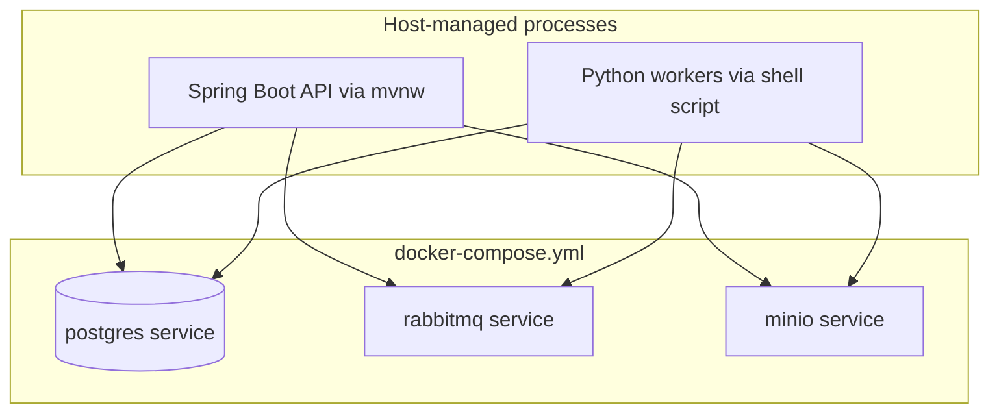
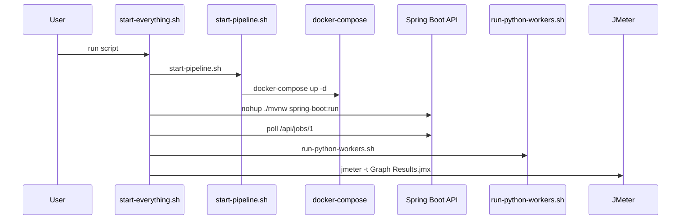

# Deployment And Startup

This repository is optimized for local/dev startup rather than hardened production deployment.

Related docs:

- [Config](./09-config.md)
- [Security](./11-security.md)

## Docker

The repository includes [`docker-compose.yml`](../docker-compose.yml), and it provisions:

- PostgreSQL
- RabbitMQ
- MinIO

It does **not** provision:

- the Spring Boot API container
- worker containers
- a reverse proxy

## Docker Compose

Defined services:

### `rabbitmq`

- image: `rabbitmq:3-management`
- ports:
  - `5672` AMQP
  - `15672` management UI
- volume: `rabbitmq_data`
- health check: `rabbitmq-diagnostics ping`

### `minio`

- image: `minio/minio:latest`
- command: `server /data --console-address ":9001"`
- ports:
  - `9000` API
  - `9001` console
- volume: `minio_data`
- health check: HTTP live probe

### `postgres`

- image: `postgres:16`
- ports:
  - `5432` PostgreSQL
- volume: `postgres_data`
- health check: `pg_isready -U postgres -d audiopipeline`

## Reverse Proxy

There is no reverse proxy configuration in the repository.

Missing:

- Nginx
- Traefik
- HAProxy
- ingress manifests
- TLS termination config

Any mention of reverse proxy behavior would be speculative, so there is none documented beyond this absence.

## CI/CD

There is no CI/CD definition in the repository.

Missing artifacts:

- GitHub Actions workflows
- Jenkinsfiles
- GitLab CI config
- deployment manifests
- release automation

The closest thing to a build pipeline is the local Maven build plus shell scripts.

## Build Pipeline

### Java build

Driven by Maven Wrapper:

- [`AudioPipeline/mvnw`](../AudioPipeline/mvnw)
- [`AudioPipeline/.mvn/wrapper/maven-wrapper.properties`](../AudioPipeline/.mvn/wrapper/maven-wrapper.properties)

Typical commands:

- `./AudioPipeline/mvnw -f AudioPipeline/pom.xml test`
- `./AudioPipeline/mvnw -f AudioPipeline/pom.xml spring-boot:run`

### Python worker bootstrap

Driven by:

- [`scripts/run-python-workers.sh`](../scripts/run-python-workers.sh)
- [`scripts/start-pipeline.sh`](../scripts/start-pipeline.sh)

Behavior:

- create `workers/venv` if missing
- install `requirements.txt`
- source `workers/.env`
- background worker processes with logs and PID files

## Startup Process

### Option 1: `start-everything.sh`

[`scripts/start-everything.sh`](../scripts/start-everything.sh) does:

1. create `runtime/`
2. run `start-pipeline.sh`
3. start Spring Boot API in background and write `runtime/api.pid`
4. poll `http://localhost:8080/api/jobs/1`
5. start Python workers
6. launch JMeter with the checked-in test plan

Important caveats:

- API readiness check assumes `/api/jobs/1` becomes a success indicator, but on a fresh DB it throws `Job not found: 1`
- the script treats any HTTP response as liveness because it only checks that `curl` returns output
- it automatically launches JMeter at the end, which is unusual for a generic startup script

### Option 2: `start-pipeline.sh`

[`scripts/start-pipeline.sh`](../scripts/start-pipeline.sh) does:

1. verify Docker, Python, and Java exist
2. run `docker-compose up -d`
3. sleep 10 seconds
4. check RabbitMQ and MinIO health
5. create/install `workers/venv` if needed
6. copy `workers/.env.example` to `workers/.env` if missing
7. print manual next steps for starting API and workers

### Option 3: legacy `start-services.sh`

[`scripts/start-services.sh`](../scripts/start-services.sh) bypasses Compose and directly `docker run`s:

- `minio`
- `rabbitmq`

This duplicates what Compose already does, with different container names than the Compose file uses.

## Shutdown Process

### `stop-python-workers.sh`

- reads worker PID files
- sends `kill`
- removes PID files

### `stop-everything.sh`

1. stops Python workers
2. stops API PID from `runtime/api.pid`
3. runs `docker-compose down`

### `stop-services.sh`

- stops direct-run `minio` and `rabbitmq` containers

## Production Readiness Assessment

What exists:

- local infra bootstrap
- health checks for containers
- reproducible queue/storage startup

What does not exist:

- containerized API/worker deployment story
- environment promotion strategy
- secret injection strategy
- observability stack
- autoscaling
- rollout/rollback
- reverse proxy / TLS
- CI/CD automation

This is best described as a development/demo deployment setup, not a production deployment system.
